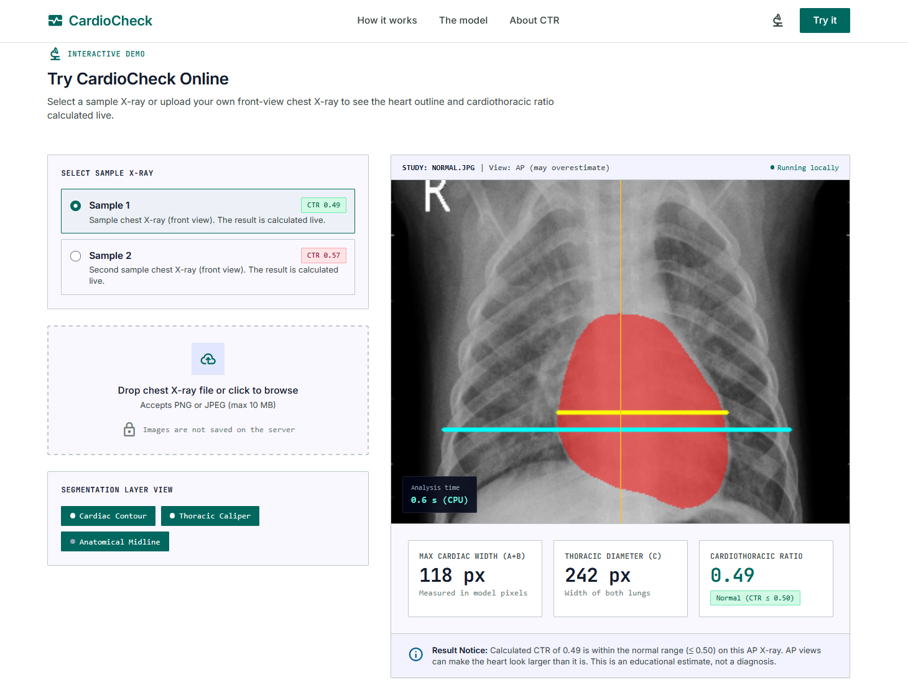
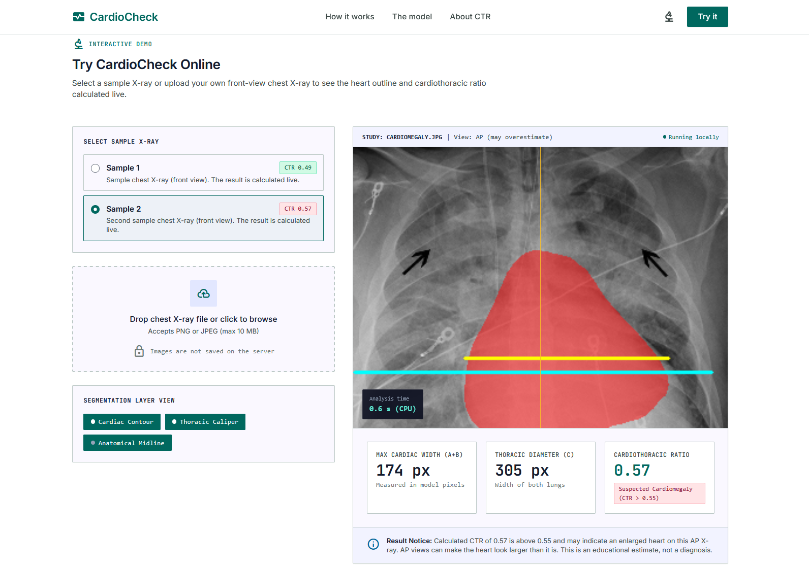
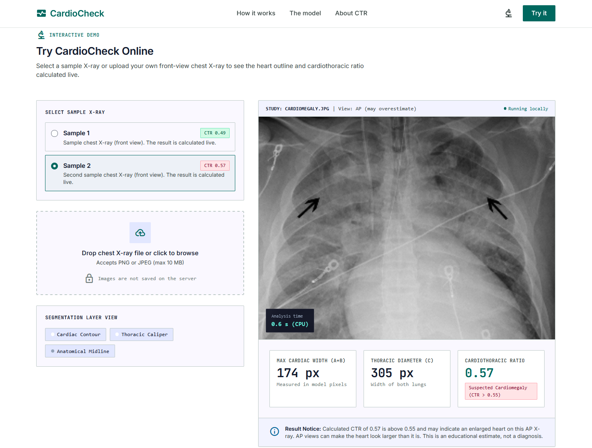

# CardioCheck

CardioCheck estimates heart size from a front-view chest X-ray. It segments the heart and both lungs with a pretrained U-Net, measures their widths, and computes the cardiothoracic ratio (CTR). If the ratio is above 0.50, the result is flagged as possible cardiomegaly.

This is a university project built for learning and demonstration. It is not a medical device. See [Disclaimer](#disclaimer).



## Contents

- [How it works](#how-it-works)
- [Features](#features)
- [Screenshots](#screenshots)
- [Tech stack](#tech-stack)
- [Project structure](#project-structure)
- [Getting started](#getting-started)
- [Usage](#usage)
- [API reference](#api-reference)
- [Understanding the CTR](#understanding-the-ctr)
- [Model details](#model-details)
- [Limitations](#limitations)
- [Privacy and security](#privacy-and-security)
- [Troubleshooting](#troubleshooting)
- [Disclaimer](#disclaimer)
- [Acknowledgements](#acknowledgements)
- [Authors](#authors)

## How it works

1. You upload a PNG or JPEG chest X-ray in the browser.
2. The Flask server reads the file in memory and passes the bytes to `model.py`.
3. The image is decoded as grayscale, preprocessed, and run through the segmentation model on CPU.
4. The model also predicts the view (AP, PA or Lateral). Lateral images are rejected with a clear error message.
5. The heart and lung masks give two horizontal widths in pixels: the widest part of the heart and the widest part of both lungs.
6. CTR is `heart_width / lung_width`, rounded to two decimals.
7. The server returns the numbers plus four PNG images (annotated picture, plain X-ray, heart overlay, measurement lines) as base64 data URLs. The page stacks the overlays on the plain image so you can switch each one on and off.

Nothing is written to disk. The upload exists only in memory while the request is handled.

## Features

- Heart and lung segmentation in a single forward pass
- Automatic view detection, with rejection of lateral films
- CTR calculation with the measurement lines drawn on the image
- Toggleable overlays: cardiac contour and thoracic caliper
- Three-level result in the UI: Normal, Borderline, Suspected cardiomegaly
- Warning when the image is an AP view, since AP films make the heart look larger
- Two built-in sample images that are analyzed live on page load
- CPU-only inference, no GPU needed
- Upload size limit of 10 MB, enforced by the server

## Screenshots

**Suspected cardiomegaly.** The second sample returns a CTR above 0.55 and a red status badge.



**Overlays off.** The layer buttons hide the heart outline and the measurement lines, so you can inspect the plain X-ray.



## Tech stack

| Layer | Tools |
| --- | --- |
| Backend | Python 3, Flask |
| Model | PyTorch, Hugging Face `transformers`, [`ianpan/chest-x-ray-basic`](https://huggingface.co/ianpan/chest-x-ray-basic) |
| Image handling | OpenCV, NumPy |
| Frontend | HTML, Tailwind CSS (compiled to `style.css`), vanilla JavaScript |
| Fonts | Inter, JetBrains Mono, Material Symbols (served locally from `public/fonts`) |

## Project structure

```
.
├── server.py          Flask app: serves the page and exposes POST /predict
├── model.py           Loads the model and runs the analysis
├── README.md
├── LICENSE
├── docs/
│   └── screenshots/   Images used in this README
│       ├── result-normal.png
│       ├── result-cardiomegaly.png
│       └── overlays-off.png
└── public/
    ├── index.html     Page markup
    ├── style.css      Compiled Tailwind styles
    ├── script.js      Upload, API calls, overlays, result rendering
    ├── fonts/         Local font files
    ├── images/        Favicons and the hero image (xray-sample.jpg)
    └── samples/
        ├── normal.jpg
        └── cardiomegaly.jpg
```

## Getting started

### Requirements

- Python 3.9 or newer
- About 1 GB of free disk space for PyTorch and the model weights
- Internet access on the first run, to download the model (about 90 MB) from Hugging Face

### Install

Create a virtual environment first so the packages stay out of your system Python.

```bash
python -m venv .venv

# Windows
.venv\Scripts\activate

# macOS / Linux
source .venv/bin/activate

pip install flask opencv-python-headless numpy torch transformers
```

The model repository ships its own loading code, and that code may need extra packages such as `timm` or `segmentation-models-pytorch`. If the first start fails with an `ImportError`, read the [model card](https://huggingface.co/ianpan/chest-x-ray-basic) and install what it lists. Once everything works, run `pip freeze > requirements.txt` and commit that file so other people get the same versions you tested with.

### Run

```bash
python server.py
```

Open `http://127.0.0.1:5000` in your browser.

The first start is slow because the weights are downloaded and cached under `~/.cache/huggingface`. Later starts load from the cache. The model is loaded once when `model.py` is imported, not on each request.

### Samples

The page looks for `public/samples/normal.jpg` and `public/samples/cardiomegaly.jpg` when it loads. If either is missing, you will see a "Sample image not found" message. Use front-view (PA) chest X-rays only, and make sure you have the right to use the images you add.

## Usage

1. Open the page and scroll to **Try CardioCheck Online**.
2. Pick one of the two samples, or drop your own PNG or JPEG file on the upload area.
3. Wait a few seconds. On a typical laptop CPU, expect roughly 1 to 5 seconds per image, shown in the "Analysis time" box.
4. Read the heart width, chest width, CTR and status badge.
5. Use the layer buttons to show or hide the heart outline and the measurement lines.

## API reference

### `POST /predict`

Send the image as `multipart/form-data` with the field name `image`.

```bash
curl -X POST http://127.0.0.1:5000/predict \
  -F "image=@public/samples/normal.jpg"
```

Successful response (`200`), with the long base64 strings shortened:

```json
{
  "view": "PA",
  "heart_width": 412,
  "chest_width": 905,
  "ctr": 0.46,
  "result": "Normal heart size",
  "image": "data:image/png;base64,...",
  "base": "data:image/png;base64,...",
  "heart_layer": "data:image/png;base64,...",
  "lines_layer": "data:image/png;base64,..."
}
```

The numbers above are only an example of the shape. Widths are in pixels of the model's preprocessed image, not in millimetres.

| Field | Meaning |
| --- | --- |
| `view` | `AP` or `PA` |
| `heart_width` | Horizontal extent of the heart mask, in pixels |
| `chest_width` | Horizontal extent of both lung masks, in pixels |
| `ctr` | `heart_width / chest_width`, two decimals |
| `result` | `"Possible cardiomegaly"` if CTR is above 0.50, otherwise `"Normal heart size"` |
| `image` | Full picture with heart mask and both lines drawn in |
| `base` | Plain X-ray with no overlay |
| `heart_layer` | Transparent PNG with the heart mask |
| `lines_layer` | Transparent PNG with the two measurement lines |

Errors return JSON in the form `{"error": "message"}`:

| Status | When |
| --- | --- |
| `400` | No `image` field, file cannot be decoded, lateral view, or heart or lungs not found |
| `413` | File is larger than 10 MB |

## Understanding the CTR

The cardiothoracic ratio compares the width of the heart with the width of the chest. A manual reading uses calipers on a PA film. CardioCheck replaces the calipers with segmentation masks.

The page groups the value into three levels:

| CTR | Level |
| --- | --- |
| 0.50 or below | Normal |
| 0.51 to 0.55 | Borderline |
| Above 0.55 | Suspected cardiomegaly |

The `/predict` endpoint uses a single cutoff at 0.50 for its `result` string. The three-level grouping is done in `script.js`. If you change one, change the other so they agree.

## Model details

- **Weights:** `ianpan/chest-x-ray-basic` on Hugging Face
- **Architecture:** U-Net with an EfficientNetV2-S encoder
- **Size:** about 22.2 million parameters, roughly 90 MB
- **Outputs:** masks for right lung, left lung and heart, plus a view classification (AP, PA, Lateral)
- **Training data:** chest X-rays from CheXpert and NIH Chest X-ray, with masks from CheXmask
- **Reported view classification accuracy:** 99.42% (AP, PA, Lateral), as published by the model author

The accuracy figure comes from the model's own documentation. We did not run our own evaluation, so treat it as the author's number and not as a result for this application. If you want a number you can defend, measure CTR on a labelled set and compare it with radiologist measurements.

## Limitations

- A single-image CTR is a rough estimate. Two radiologists can disagree on the same film.
- The standard method measures chest width at the inner rib margin. This project uses the width of both lung masks, which usually gives a slightly different value.
- The 0.50 cutoff is meant for adult PA films. Children have a higher normal range, and AP films overestimate heart size.
- Poor inspiration, rotation, pacemakers, large pleural effusions or unusual anatomy can cause bad segmentation. The code only checks that a heart and lungs were found, not that the outlines are correct. Look at the overlay before trusting a number.
- A normal CTR does not rule out heart disease, and a high CTR does not confirm it.
- The model was not tested or cleared for clinical use.

## Privacy and security

- Uploaded images are processed in memory and are not saved.
- Do not upload images that contain patient identifiers, and do not use real patient data without proper approval.
- The model is loaded with `trust_remote_code=True`, which runs Python code from the Hugging Face repository on your machine. Pin a specific revision in `from_pretrained(..., revision="<commit hash>")` once you have reviewed the code, so a later change upstream cannot affect you.
- `server.py` starts Flask's built-in development server with `debug=False`. That is fine for a demo on your own machine. For anything public, run it behind a production WSGI server such as Gunicorn or Waitress, put a reverse proxy with HTTPS in front, and add rate limiting.
- The 10 MB upload limit is set in `server.py` through `MAX_CONTENT_LENGTH`.

## Troubleshooting

**The page says "Could not reach the server."**
The Flask process is not running, or you opened `index.html` directly from disk. Start `python server.py` and use the `http://127.0.0.1:5000` address.

**"Could not read this image."**
The file is corrupt or not a real PNG or JPEG. Re-export it and try again.

**"This is a side-view X-ray."**
The model classified the image as a lateral view. Upload a front-view film.

**"Heart or lungs not found."**
Segmentation failed, often on cropped, rotated or very low-contrast images. Try a cleaner front-view film.

**"The server is still running the old heart_model.py."**
This message comes from `script.js` and uses outdated file names. The backend files are now `server.py` and `model.py`. If you see it, restart the server and check that `model.py` returns the `base`, `heart_layer` and `lines_layer` fields.

**First start takes a long time or fails.**
The weights are being downloaded. Check your connection and the free space in your Hugging Face cache folder.

## Disclaimer

CardioCheck is a student project for education and demonstration. It is not a medical device, has not been validated for clinical use, and must not be used to diagnose, treat or make decisions about any person's health. If you are worried about your heart, see a doctor.

## Acknowledgements

- [`ianpan/chest-x-ray-basic`](https://huggingface.co/ianpan/chest-x-ray-basic) for the pretrained segmentation and view model
- CheXpert (Stanford ML Group) and the NIH Chest X-ray dataset, used to train that model
- CheXmask, the source of the heart and lung masks used in training
- Flask, PyTorch, Hugging Face Transformers, OpenCV and Tailwind CSS

Check each dataset and model page for its own license and citation requirements before you redistribute anything built on them.

## Authors

Ali Asghar and Nouma Shaikh

## License

The source code in this repository is released under the [MIT License](LICENSE).

The license covers our code only. The pretrained model, the datasets it was trained on, and any X-ray images you add keep their own licenses and terms. The MIT license does not turn this project into a medical device, and the warranty disclaimer in it applies in full: use at your own risk, and not for clinical decisions.
